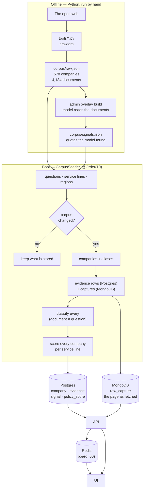

# The flow, end to end

One picture, then the same path in prose. Every arrow here is a real step in
this repository, with the file named beside it.

## In prose

### 1. The web is crawled offline, not at runtime

There is **no crawler in the Java application.** Scraping is Python in `tools/`,
run by hand, and it writes one committed file: `api/src/main/resources/corpus/raw.json`
— **578 companies and 4,184 documents** as shipped. `build_corpus.py` takes news
(search RSS), job boards (Greenhouse, Lever, Ashby, SmartRecruiters), the GLEIF
registry and SEC EDGAR filings. `fast_corpus.py` does the breadth pass.
`sanitize_corpus.py` drops any document that cannot be about the company it is
filed under, and `verify_corpus.py` is the CI gate on the result.

The app never fetches a page. It reads that file, which is why the demo works
with the network unplugged. See [02-ingestion.md](02-ingestion.md).

### 2. The model can read ahead of time, into a second file

Optionally, an admin endpoint (`POST /api/admin/signals/build`) walks every
stored document, asks the model the questions the cheap engine could not settle,
and **writes the quotes it found** to `corpus/signals.json`. As shipped that file
holds **8,516 rows, 7,755 of them "no match"** — about 761 rows carry a real
verdict and a quote. That file is the **overlay**: a pre-computed model pass,
shipped as data so a demo never waits on an API. See [03-reading.md](03-reading.md).

### 3. Boot seeds and, if the corpus moved, ingests

`CorpusSeeder` runs first (`@Order(10)`). It seeds the policy questions, the
service lines and the regions, then fingerprints `raw.json + signals.json` and
compares it with the stored `corpus_state`. Same fingerprint → nothing is
re-ingested, and the instance starts in seconds. A different one → the full
ingest:

1. **companies + aliases** — IDs are deterministic (`UUID.nameUUIDFromBytes`), so
   re-seeding preserves identity rather than duplicating.
2. **evidence rows** in Postgres, and **captures** in MongoDB — the page text
   exactly as fetched, kept whole so every quote can be re-found. Evidence and
   capture are joined by `evidence_key`.
3. **documents that vanished** from the corpus are evicted: their signals,
   evidence rows and captures.
4. **classify every (document × question) pair** — on virtual threads. This is
   the expensive step and the reason the overlay exists.
5. **score every company on every service line**, and store the result.

### 4. Reading happens once per pair, and is cached

Each pair is answered by, in order: the **overlay** if it holds an answer, then
the **router**, which picks the local rubric engine or the model. Model answers
are cached in Postgres (`classification_cache`), keyed by document hash ×
question × engine, so the same document is never paid for twice. See
[03-reading.md](03-reading.md).

### 5. Scoring is a pure function over what was stored

No network, no model. Signals in, one probability per company per service line
out, plus every intermediate term so the card can explain itself. See
[04-scoring.md](04-scoring.md).

### 6. Serving

`GET /api/companies` returns the board — the score, the band, the top signals
with their spans — cached in Redis for 60 seconds. `GET /api/evidence/{id}/capture`
returns the whole stored page, which is what the click from a claim opens. See
[05-serving.md](05-serving.md).

### 7. Re-scoring is not re-crawling

A scheduled job every 12 hours re-scores every service line over the documents
already stored. It does **not** fetch anything. New pages arrive by re-running
the Python and booting, which is a deliberate line: the demo's data cannot
change under it mid-presentation.
