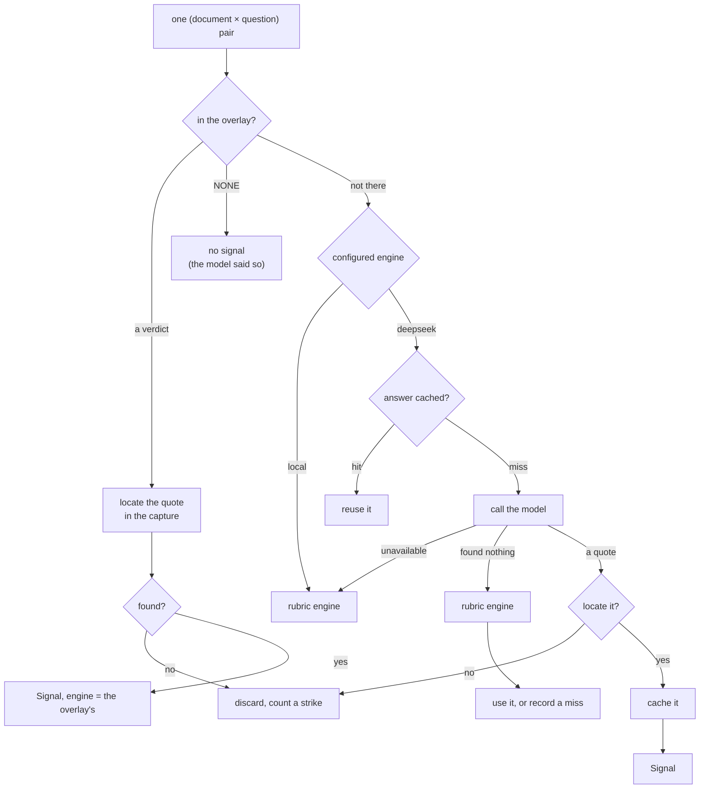

# How a sentence is found, and proved

The question this layer answers, for every pair of (document, policy question):

> Does this document say the thing the question asks about — and if so, **which
> words say it?**

The second half is not optional. A reader that returns *"yes, probably"* is
useless here, because the product's promise is that a rep can click the claim
and land on the sentence.

## The questions come first, and they are authored

`PolicyLibrary` holds **25 policy questions** in Java — six for Intelligent
Automation, five for Data & AI, four for Cybersecurity, three each for Cloud,
ERP and Digital Customer Experience. Each one carries:

| Field | Why it is there |
|---|---|
| `text` | the question, in plain words — "Has the company announced an efficiency programme with a quantified target?" |
| `instructions` | **the rubric**: what counts, what does not, in the authors' words |
| `weightTier` | HIGH / MEDIUM / LOW → 1.5 / 0.7 / 0.3 nats |
| `polarity` | POSITIVE, NEGATIVE, or **DISQUALIFYING** — the last one removes a company from the queue |
| `theme` | efficiency, capability, platform, compliance, incident… — what the theme cap counts |
| `decayClass` | EVENT 30d, HIRING 90d, STRUCTURAL 180d |
| `cues`, `counterCues` | the phrases the offline engine matches on |

**This is the product.** The model is a reader; these are the questions worth
asking, and they were written by someone who knows what a company about to buy
looks like. Nothing here is learned or inferred at runtime.

A question is never deleted, only deactivated — a stored signal must always be
able to name the question that produced it.

## Two readers, one interface

```java
interface ClassifierEngine {
    String id();
    boolean available();
    List<Finding> classify(ClassificationRequest request);
}

record Finding(Verdict verdict, double confidence,
               int spanStart, int spanEnd, String rationale)
```

A `Finding` cannot exist without a span. There is no constructor for an opinion.

### The rubric engine — the default

`LocalRubricEngine` (`local-rubric-v1`) is deterministic, in-process, and always
available. No key, no network, no latency.

It splits the document into **three-sentence windows with one sentence of
overlap**, scores each window against the question's cues and counter-cues, and
returns the windows that clear a floor.

- A cue's weight rises with how specific it is (`multiplier × words^0.85`), so
  "sap s/4hana" counts for more than "sap".
- Counter-cues weigh **1.5×**, and a hard-coded list of page furniture — privacy
  policy, "equal opportunity employer", "apply now" — weighs **1.6×**, because
  every job ad on the internet contains those and none of them are evidence.
- A window's confidence is `1/(1+e^(−0.6·(score−1.35)))`, and anything under the
  configured floor is *rejected* rather than returned.

The rejected windows are not thrown away. They are what the **below-the-floor**
review queue is made of: things the cheap reader saw and was not sure about.

### The model — the second opinion

`DeepSeekEngine` (`deepseek-flash@deepseek`) is available only when an API key is
configured. Temperature 0, JSON response, and a system prompt that asks for the
quote **copied character-for-character** and under 240 characters.

Then the important part: **`SpanLocator` has to find that quote in the stored
document.** If it cannot, the answer is discarded and the strike counter goes up.
A model finding cannot enter the system without a locatable span.

It is defensive about everything else too — retries with backoff on 429/402/503,
a salvager that recovers a quote from a truncated JSON answer — but none of that
matters if the quote is not in the page.

## How the router chooses



Three things fall out of that picture:

**The overlay is consulted first.** It is a pre-computed model pass shipped as
`corpus/signals.json` — 8,516 rows, of which 7,755 say "no match". It exists so a
demo never waits on an API, and so the same pass can be reviewed before it ships.
A pair the overlay does not answer falls through to the live readers.

**The default engine is `local`.** As shipped, `CLASSIFIER_ENGINE=local`, so the
rubric engine answers everything and the model is never called. That is not a
degraded mode — it is the design. The model is switched on where it earns its
cost.

**Every fallback lands on the cheap reader, never on an error.** Model
unavailable, model returns nothing, the call throws — all of them fall back to
the rubric engine. And every model answer is cached in Postgres
(`classification_cache`, keyed by document hash × question × engine) *including
its misses*, so the same document is never paid for twice.

## What a reading is worth, once found

The reader returns a verdict out of `BUY`, `COUNTER`, `BUILD` or `NONE`. Which
one *counts* is the question's business, not the reader's:

| Question polarity | Counts when the verdict is |
|---|---|
| POSITIVE | `BUY` |
| NEGATIVE | `COUNTER` or `BUILD` |
| DISQUALIFYING | `BUILD` |

Anything else scores **zero, not negative**. "We read it and it said nothing" is
not the same as "we read it and it said no" — and a system that punishes silence
will quietly punish companies nobody has written about yet.

## What is *not* AI here

- The thresholds, weights, decays and caps — settings, authored or chosen.
- The score — arithmetic, in [04-scoring.md](04-scoring.md).
- The decision to disqualify — a gate, in code.
- The question — written by a person, with a rubric.

The model reads sentences. That is the whole of its job, and keeping it that
narrow is what makes the rest checkable.
