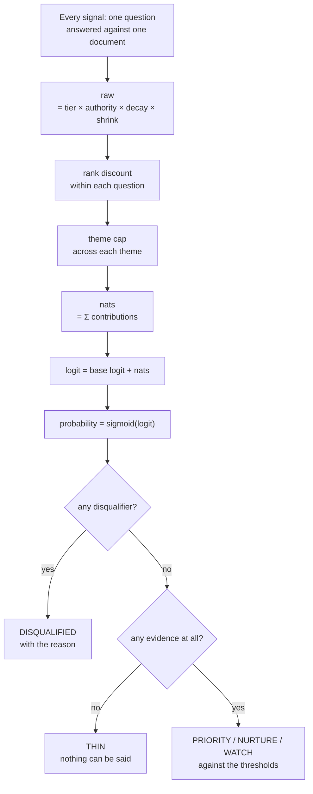
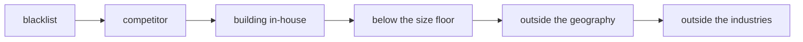

# How a company is scored

One number per company per service line: the probability that this company is
worth calling about that line, right now. It is built from the sentences we
found, and every part of it can be pointed at.

The whole thing lives in `ScoringService.compute` — one pure function over
(company, its evidence, its signals, the policy questions, the settings). No
network calls, no model calls: by the time it runs, the reading is already done.

## The shape of it



## Step 1 — what one signal is worth

A **signal** is one policy question answered against one document. The engine
that answered it returns a verdict and a confidence; the question carries the
weight. `ScoringService.compute` turns that into a number of *nats* — the same
unit logistic regression uses, so the arithmetic below is a plain log-odds sum.

```
raw = tierNats × sourceAuthority × decay × shrink
```

| Factor | Where it comes from | Values |
|---|---|---|
| `tierNats` | the question's weight tier, signed by polarity | HIGH **1.5**, MEDIUM **0.7**, LOW **0.3** |
| `sourceAuthority` | how much this document is worth, stored on it at ingest and defaulted from its kind | REGISTRY/FILING **1.0**, STRATEGY **0.95**, JOB_POSTING/NEWSROOM **0.9**, NEWS **0.85** |
| `decay` | how stale the document is | `2^(−ageDays / halfLife)`, floored at **0.02** |
| `shrink` | how much the reading's own confidence counts | see below |

**The verdict decides whether the weight applies at all.** A question asserts
only on the verdict it expects — a positive question on `BUY`, a negative one on
`COUNTER` or `BUILD`, a disqualifying one on `BUILD`. Any other verdict scores
zero rather than a negative, so "we read it and it said nothing" is not the same
as "we read it and it said no".

**Decay has three speeds**, from the question's decay class: an event is worth
half as much after **30 days**, hiring after **90**, a structural claim after
**180**. A company that announced a cost programme two years ago is not in the
market for one today, and the score should say so without anyone adjusting it.

**The confidence shrink** is a setting, not a constant:

```
shrink = 2 × (0.5 + (confidence − 0.5) × k) − 1
```

At `k = 1` the arithmetic is untouched. Lower pulls every reading toward "don't
know", so one over-confident reading cannot carry a company on its own. This is
a dial rather than a number because the right amount depends on which engine is
reading — a model's 0.9 is not a regex's 0.9.

## Step 2 — the second sentence is worth less

Within one question, the strongest signal counts in full, the next at
`rankDiscount¹`, then `²`. Twelve job postings for the same role are one fact
repeated, not twelve facts, and this is what stops a company that posts often
from outranking a company that is actually buying.

## Step 3 — the theme cap

Every question sits in a theme — *efficiency*, *capability*, *platform*,
*compliance*, *incident*. Signals are summed per theme, and any theme whose
total exceeds the cap is scaled down so it lands exactly on it:

```
cap = priorityLogit − baseLogit
scale = (cap − 0.001) / |theme total|
```

The cap is expressed as a *distance*: it is exactly the amount of evidence
needed to get from the base rate to the Priority line. So one loud topic can
carry a company all the way to Priority and no further — which is why a company
with three themes is worth more than a company with the same evidence in one.
The UI shows this as "capped · one theme".

## Step 4 — one number

```
nats  = Σ contribution            (over every signal that is not disqualifying)
logit = baseLogit + nats
p     = 1 / (1 + e^−logit)
```

`baseLogit` is `ln(baseRate / (1 − baseRate))`, where the base rate — **0.25** by
default — is the share of the pool worth calling at all. Everything is measured
against that, so a company scores well by beating the market rather than by
clearing a fixed bar. A company we have never read a document about scores
exactly the base rate.

## Step 5 — the gates run outside the sum

Disqualifiers are not weights, and no amount of positive evidence cancels one.
They are checked separately, in this order, and the first to fire is the reason
shown on the card:



- **blacklist** — a name or domain a rep excluded by hand
- **competitor** — sells what we sell, or is on the vendor register
- **building in-house** — a disqualifying question (polarity `DISQUALIFYING`) asserted
- **size floor** — below `icpMinEmployees`, only when size confidence ≥ **0.8**
- **geography / industry** — outside the countries or industries in Qualification

A gated company is `DISQUALIFIED`, keeps its score on the card, and carries the
sentence that removed it.

## Step 6 — the band

| Band | Meaning |
|---|---|
| **PRIORITY** | at or above the Priority line — pick up the phone |
| **NURTURE** | above Nurture — keep close |
| **WATCH** | above Watch — worth watching |
| **THIN** | no positive evidence at all; nothing can be said either way |
| **DISQUALIFIED** | a gate removed it |

`THIN` is not a low score, it is the absence of one. A company we have never
found a sentence about is not a bad prospect, it is an unread one, and the UI
says "Unproven" rather than showing it as weak.

## What else comes off the same ledger

- **Horizon** — the day the score would fall past a threshold if nothing new
  arrives. Computed by projecting the decay forward and bisecting on the day, 40
  iterations. "It holds for about 62 more days."
- **Sensitivity** — the score again at half-lives of 30, 90 and 180 days, so a
  reader can see whether the number depends on the decay assumptions.
- **Weakest link** — the signal the score most leans on.
- **Themes and corroboration** — how many distinct themes carry it, which is
  what the theme cap makes matter.

## Why it is built this way

- **Additive log-odds**, not a checklist. Each fact shifts the odds, and the
  shift is the same wherever it appears, so the total is explainable by
  construction rather than by inspection.
- **Every term is a setting.** Base rate, thresholds, rank discount, theme cap,
  confidence shrink, size floor, geography and industries all live in
  Qualification/Scoring and are editable without a deploy.
- **Nothing is a model's opinion of a company.** The model's job is to answer
  one question about one sentence and hand back the span it read. The score is
  arithmetic over those answers, computed by code that can be read.
