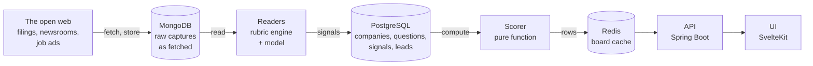

# Nudge — architecture

How a page on the internet becomes a company at the top of a call list. Read in
order; each file is short and the diagrams carry the shape.

| File | What it answers |
|---|---|
| [01-flow.md](01-flow.md) | The end-to-end path in one picture |
| [02-ingestion.md](02-ingestion.md) | Where the data comes from, and what is stored where |
| [03-reading.md](03-reading.md) | How a sentence is found and proved — the two readers |
| [04-scoring.md](04-scoring.md) | The arithmetic that turns sentences into a number |
| [05-serving.md](05-serving.md) | What the API serves, and what it caches |

## The system in one box

## The four ideas it is built on

**1. A claim without a span is not a claim.**
Every reading stores the character range it came from, inside a document we
hold. Nothing reaches a screen unless it can be pointed at. This is the rule the
rest of the design falls out of — see [03-reading.md](03-reading.md).

**2. Reading and judging are separate steps.**
A reader answers *does this sentence say X* and returns words. The scorer turns
those answers into a number. The reader never sees a company; the scorer never
calls a model. Either can be replaced without touching the other.

**3. The cheap path is the default, not the fallback.**
A deterministic rubric engine runs in-process, offline, instantly. The model is
a second opinion used where it earns its cost. Every screen has a working answer
with the network unplugged.

**4. Nothing is hard-coded.**
Base rate, thresholds, the weights of questions, what disqualifies a company,
which industries and countries count — all of it is data, editable on a screen,
live. See [04-scoring.md](04-scoring.md) for what each one does.

## The stack

| Piece | What | Where |
|---|---|---|
| UI | SvelteKit 5, single page | `ui/` |
| API | Spring Boot, Java 25 | `api/` |
| Documents | MongoDB 7 — the capture as fetched | `api/.../repository/mongo` |
| Structured | PostgreSQL 16 — companies, questions, signals, leads | `api/.../domain` |
| Cache | Redis 7 — the computed board | `api/.../service/BoardService.java` |
| Docs | this folder | `docs/` |

## Reading order for a judge

- **Short on time:** [01-flow.md](01-flow.md), then [04-scoring.md](04-scoring.md).
- **"Is it just an LLM?":** [03-reading.md](03-reading.md).
- **"Where does the data come from?":** [02-ingestion.md](02-ingestion.md).
- **The pitch itself:** [../presentation/](../presentation/README.md).
