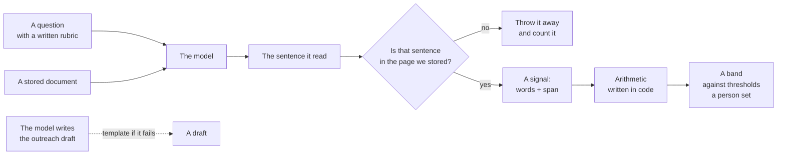

# Slide 4 — How the AI decides

## The paragraph, if you memorise nothing else

Three sentences. Every clause is something in the code, so it survives "show
me". Say it slowly; the density is the argument.

> Every company is scored for a service line by a single number: each signal —
> one authored question answered against one document — contributes a weight
> (HIGH 1.5, MEDIUM 0.7, LOW 0.3 nats) multiplied by the source's authority (a
> registry filing 1.0, a strategy page 0.95, a news report 0.85), decayed on a
> half-life the question declares (30 days for an event, 90 for hiring, 180 for
> a structural claim), shrunk toward "don't know" by the reading's own
> confidence, and discounted again for every repeat of the same question, after
> which each theme's total is capped at exactly the distance from the base rate
> to the Priority line — so one loud topic can never carry a company on its own
> — and the sum lands on the logit of the base rate, one sigmoid turns it into a
> probability, and thresholds cut it into Priority, Nurture, Watch or Unproven.
>
> Classification is deliberately not a model's opinion: a deterministic
> cue-and-rubric engine reads every document offline, a language model is an
> optional second opinion that must hand back a quote we can re-locate in the
> stored page — anything we cannot find again is discarded and counted as a
> strike — and disqualification (a blacklist entry, a competitor, a company
> building the capability in-house, below the size floor, outside the geography
> or industry) is a gate applied outside the sum, so no amount of positive
> evidence buys a company past it.
>
> For an enterprise that is the whole argument — every constant (base rate,
> thresholds, rank discount, theme cap, confidence shrink, size floor,
> geography, industries) is a setting on a screen rather than a number in code,
> every score prints its full ledger so any figure can be recomputed by hand,
> the same inputs always give the same answer because no model ever scores
> anything, and the model can be switched off entirely and the desk still runs —
> and it is validated by construction rather than by assertion: the same
> predicate the editor promises is the one the board draws from, quotes are
> re-verified against the stored capture with the failure count on screen, the
> score is recomputed at 30-, 90- and 180-day half-lives so a reader can see
> whether it depends on the decay assumptions, and rep accept/reject decisions
> feed a precision figure that we did not mark our own homework for.

---

**Slide title:** The model does not decide anything. It reads.

**On the slide:** this diagram.

> The model does exactly two things: finds a sentence, and writes a draft.
> It never scores, ranks, bands, or disqualifies a company.

---

## What to say

*~2:30. This is the slide the technical judges are waiting for. Do not rush it.*

"The obvious way to build this is to hand a model a company and ask *is this
worth calling*. We deliberately did not do that, and I want to be precise about
what we did instead.

**The model reads.** It gets one document and one question — *did this company
announce an efficiency programme with a number attached?* — and it must return
the sentence it read. Not a summary. Not a confidence. The words.

## The part that makes it safe

"It must return a quote, **and we look that quote up in the page we stored.**
Our own code — not the model — finds where those words are. If they are not
there, we throw the answer away and count it.

That number is on the Reading screen in Settings: quotations the model returned
that we could not verify, against the total it returned. It is meant to be
non-zero, because a system that has never rejected a model answer has never
checked one.

So: the model cannot invent a fact, because an invented fact has no span, and
no span means no row."

## What it never touches

"Everything downstream is arithmetic. The weight of a sentence, how stale it is,
how much a source kind is trusted, when one theme is capped — all code, all in
[../architecture/04-scoring.md](../architecture/04-scoring.md), and every
constant of it is a field on a settings screen.

And the band — Priority, Nurture, Watch, or out of the queue — is a comparison
against thresholds a person set. A model never sees a company name to have an
opinion about it."

## There are two readers, and the cheap one is the default

"This is the other half of the design. There is a deterministic engine that
matches authored cue phrases and runs in-process. It is the default. No key, no
network, no latency, and it never varies.

The model is the second opinion, used where it earns its cost, and every path
that fails — no key, no answer, call throws — falls back to the cheap reader.

Which means the demo you just saw runs with the Wi-Fi off. That is not a
gimmick; it is the guarantee that this never fails in front of a customer
because someone else's API had a bad afternoon."

## What it cost

"Because we did not want to wave our hands: the Reading screen counts how many
document-question pairs a full pass would need, how many the model actually
read, and lets you put your own price per thousand calls on the difference.
You can see what the second opinion bought and what it cost."

## Honest limits — say these before you are asked

- **The people are seeded.** Authored, marked `demo-seed` in the data. We did
  not pretend to crawl people.
- **The questions are authored, not learned.** 25 of them, written with a rubric
  each. That is the product, and it is also the ceiling — we only find what we
  thought to ask about.
- **The companies we never read are not scored.** They are counted as blind
  spots and shown as *unproven*, not as weak.
- **The overview text is composed, not generated.** The panel is labelled *AI
  Overview* but no model writes it — it is the signals assembled into sentences
  by `WhyNowService`. If someone asks what the AI writes, the honest answer is:
  the reading, and the draft. Not this.

## Transition

"That is the system. To close: the thing we would most want you to take away is
not the model. It is that every number on that screen can be traced back to a
sentence somebody actually published — and we would rather show you a score we
can defend than one we cannot."
